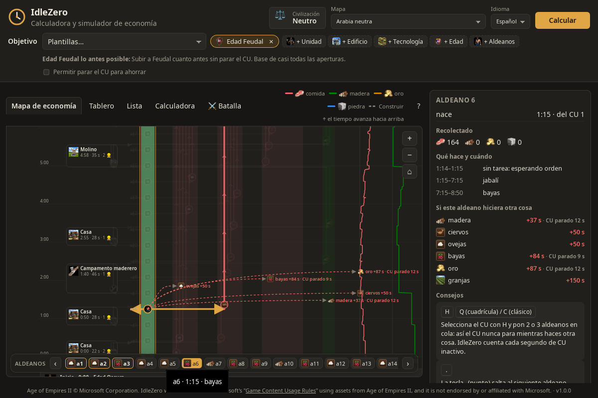
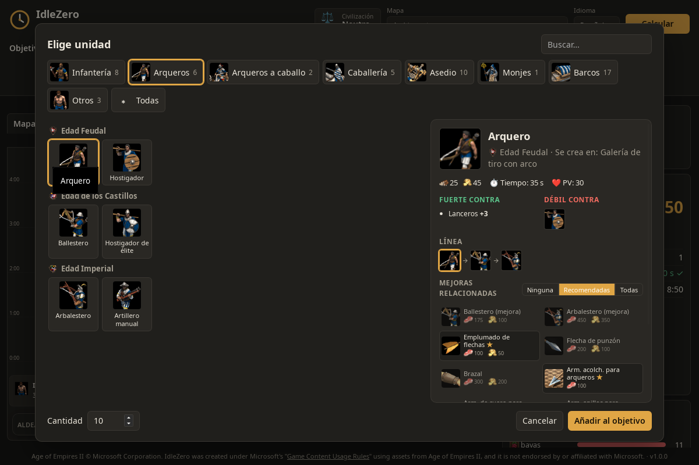
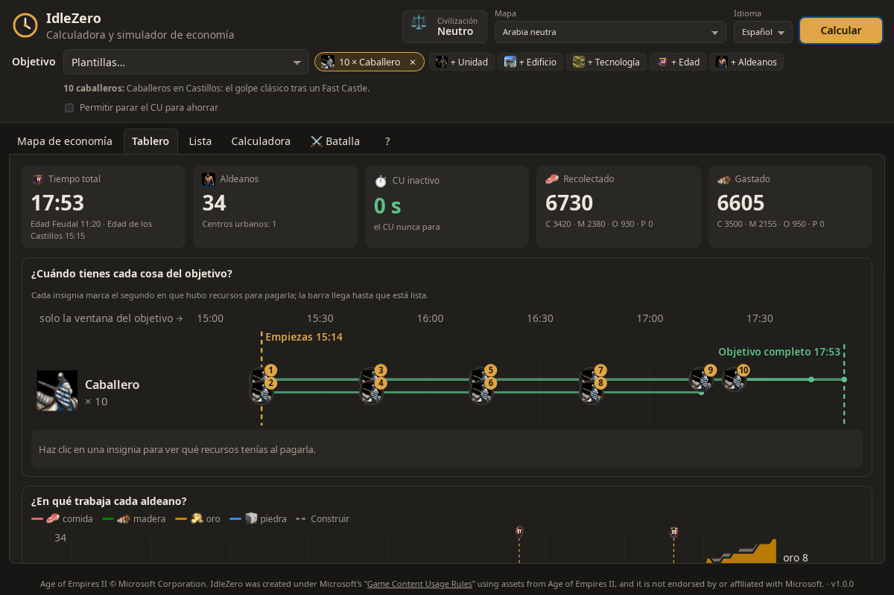
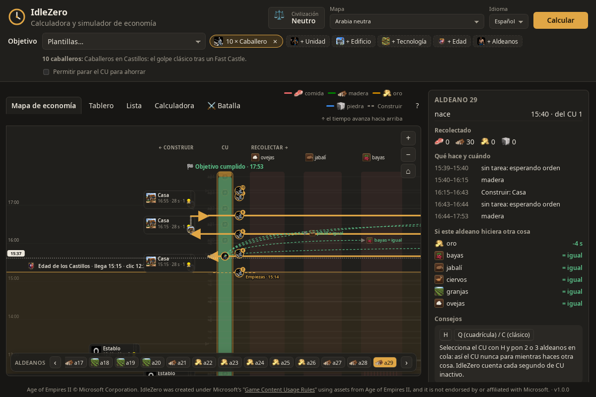
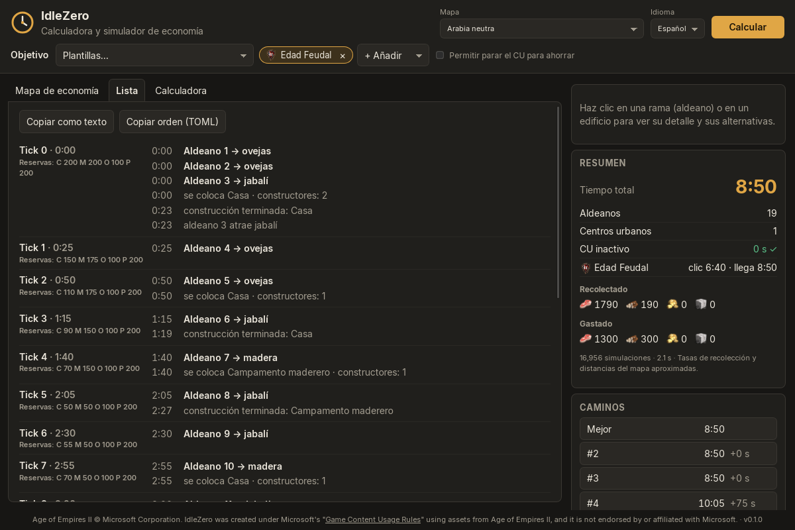
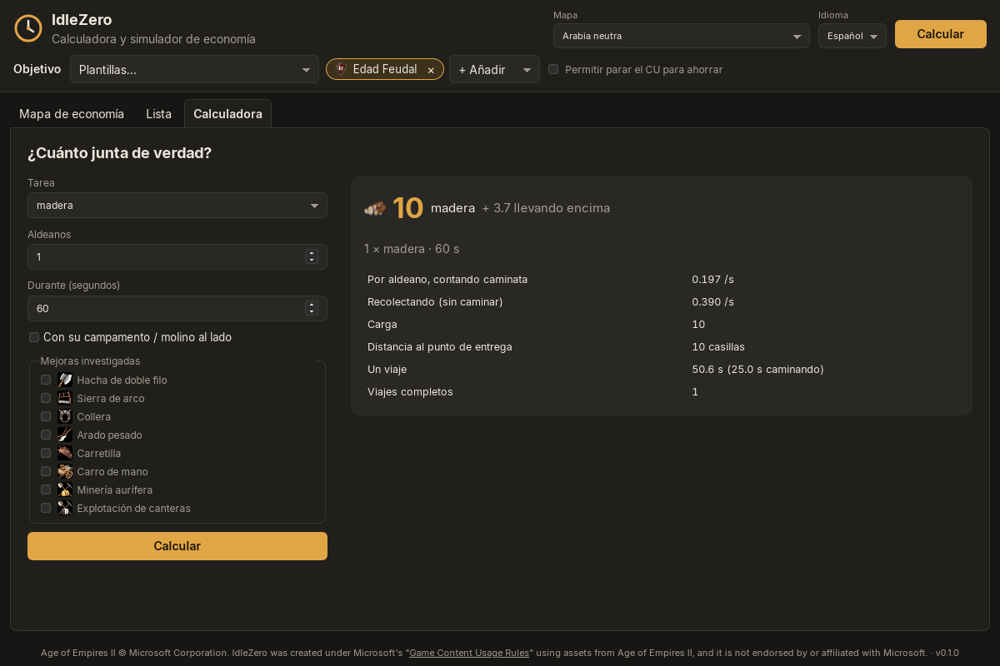
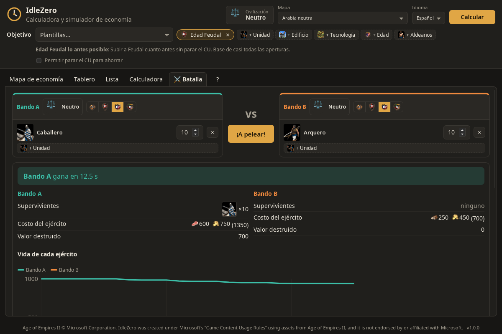
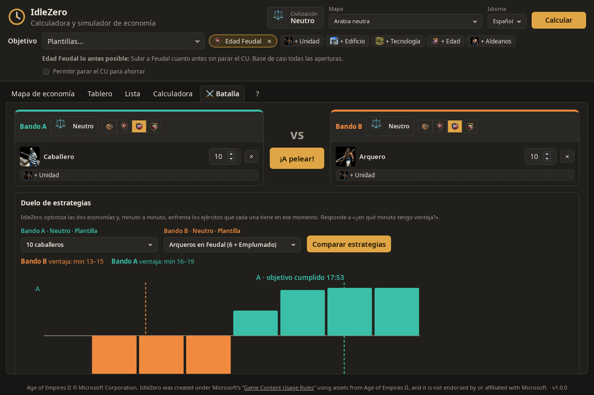
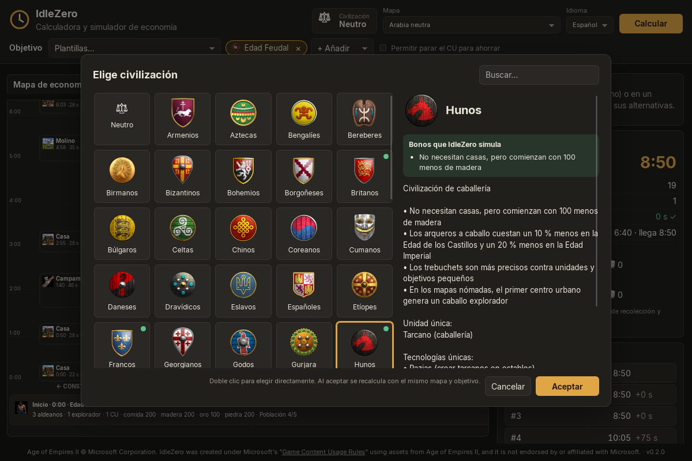

# IdleZero

**Órdenes de construcción óptimas para Age of Empires II: Definitive Edition, aldeano por aldeano.**
App de escritorio gratuita para Linux y Windows. Le dices qué quieres (Feudal, Castillos, 10 caballeros, un castillo, 3 CU…) y calcula qué hace cada aldeano, cuándo subir de edad y cuándo puedes pagar cada cosa, sin dejar el centro urbano parado.


> *English:* IdleZero is a free desktop app that computes villager-by-villager build orders for AoE2 DE and shows them as an economy map. Spanish is the default language; switch to English in the top bar.

## Para quién es

- Para quien quiere **aprender una apertura** viendo por qué funciona (qué aldeano va a dónde y por qué).
- Para quien quiere **optimizar** la suya: compara caminos, cambia la civilización y mira cuántos segundos ganas.
- Para quien quiere **comparar estrategias**: ¿en qué minuto mis arqueros ganan a sus caballeros?

## Descarga e instalación

Descarga solo desde [GitHub Releases](../../releases/latest).

| Sistema | Archivo | Cómo instalar |
| --- | --- | --- |
| Windows 10/11 | `IdleZero_1.0.0_x64-setup.exe` o `.msi` | Doble clic. Windows puede avisar «aplicación no reconocida» porque no está firmada: *Más información → Ejecutar de todas formas*. |
| Ubuntu, Debian, Mint | `IdleZero_1.0.0_amd64.deb` | `sudo apt install ./IdleZero_1.0.0_amd64.deb` |
| Fedora, openSUSE | `IdleZero-1.0.0-1.x86_64.rpm` | `sudo dnf install ./IdleZero-1.0.0-1.x86_64.rpm` |
| Cualquier Linux | `IdleZero_1.0.0_amd64.AppImage` | `chmod +x IdleZero_1.0.0_amd64.AppImage` y ábrelo. Probado en Ubuntu 22.04 limpio. |

**Verifica tu descarga.** Cada versión publica `SHA256SUMS-Linux.txt` y `SHA256SUMS-Windows.txt`:

```bash
# Linux
sha256sum -c SHA256SUMS-Linux.txt --ignore-missing
```

```powershell
# Windows (PowerShell): compara el resultado con la línea de SHA256SUMS-Windows.txt
Get-FileHash .\IdleZero_1.0.0_x64-setup.exe -Algorithm SHA256
```

Requisitos: Windows 10/11 (usa WebView2, incluido en Windows 11 y que el instalador añade si falta) o un Linux de escritorio con GTK 3. No necesita internet ni el juego instalado.

## Primeros pasos

1. Elige un **objetivo**: una plantilla (*Plantillas…*) o arma el tuyo con **+ Unidad**, **+ Edificio**, **+ Tecnología**, **+ Edad** y **+ Aldeanos**.
2. Elige tu **civilización** (botón del escudo o tecla `C`). Sus bonos económicos se aplican solos.
3. Pulsa **Calcular** (`Ctrl+Enter`). En unos segundos tienes el mejor camino que encontró. Puedes cancelar si tarda.

## Las pestañas

### Mapa de economía (`1`)


- El **tiempo sube** desde el inicio (0:00, abajo) hasta la meta (arriba).
- En el centro, el **CU**: cada círculo es un aldeano que nace. Su color dice si llevas una cantidad razonable de aldeanos para el objetivo (verde), de más (amarillo) o muchos de más (rojo).
- A la **izquierda**, lo que se construye: qué, cuándo, cuánto tarda y con cuántos constructores.
- A la **derecha**, una columna por recurso (ovejas, jabalí, bayas, ciervos, madera, oro…) y una rama por aldeano. Cada aldeano tiene su carril fijo, así las ramas no se cruzan.
- Más a la derecha, las **reservas** de cada recurso segundo a segundo.
- Abajo, la **fila de aldeanos** (a1, a2…; los iniciales resaltados). Un clic aísla la ruta de ese aldeano y el panel muestra su camino; con `←` / `→` pasas al anterior o al siguiente.



Al elegir un aldeano ves **qué pasaría si hiciera otra cosa** («+25 s», «CU parado 12 s»). Los tramos en **rojo** son tiempo sin tarea, con la causa y una sugerencia.

### Carta de unidad



Al añadir una unidad se abre una ventana como la del juego, ordenada por tipo (infantería, arqueros, caballería…) y por edad. La **carta** muestra costo, tiempo, vida, contra qué es fuerte y débil (calculado con las clases de ataque y armadura del juego), su línea de mejoras y las **mejoras relacionadas**: márcalas y se suman al objetivo.

### Tablero (`2`)



La gráfica **¿Cuándo tienes cada cosa del objetivo?** marca, por cada unidad o edificio, el segundo exacto en que hubo recursos para pagarlo y cuándo estuvo listo, con las marcas «Empiezas» y «Objetivo completo». Debajo: aldeanos por recurso en el tiempo, reservas, hitos y consejos de teclas para jugar la orden. Las mismas insignias aparecen en el mapa junto al CU.



### Lista (`3`)



La orden como texto, tick a tick (25 s), para copiarla o exportarla en TOML.

### Calculadora (`4`)



¿Cuánto junta de verdad un grupo de aldeanos en una tarea? Incluye carga, caminata, campamento y mejoras.

### Batalla (`5`)



Dos bandos frente a frente, cada uno con civilización, edad, ejército y mejoras de herrería. El resultado muestra el ganador, los supervivientes, el costo y el valor destruido, y la vida de cada ejército en el tiempo.



**Duelo de estrategias:** elige dos plantillas (por ejemplo *10 caballeros* frente a *Arqueros en Feudal*). IdleZero optimiza las dos economías y, minuto a minuto, enfrenta los ejércitos que cada una tiene en ese momento: responde a «¿en qué minuto tengo ventaja?».

### Civilizaciones (`C`)



Las 56 civilizaciones con su escudo y su texto oficial. En verde, los bonos que IdleZero **simula** (52 civilizaciones tienen alguno: recolección, costos, carga, velocidad, recursos al subir de edad…); en gris, los que **no afectan a la economía** (militares, navales, de mapa). Los bonos militares con cifras se aplican en la pestaña Batalla.

## Atajos

| Tecla | Acción |
| --- | --- |
| `1` … `5` | cambiar de pestaña |
| `Ctrl+Enter` | calcular |
| `C` | elegir civilización |
| `?` | todos los atajos |
| Rueda / `+` `-` | zoom en el mapa |
| `Mayús` + rueda | subir o bajar en el tiempo |
| `←` `→` | aldeano anterior / siguiente (con uno elegido) |
| `Inicio` / `Fin` | ir al 0:00 / a la meta |
| `Esc` | quitar la selección |

## Resultados de referencia

Arabia neutra, sin civilización, sin dejar el CU parado (valores aproximados):

| Objetivo | Tiempo |
| --- | --- |
| Edad Feudal | 8:50 |
| Edad de los Castillos (Fast Castle) | 14:25 |
| Edad Imperial (permitiendo parar el CU) | 20:30 |
| 10 caballeros | 17:53 |
| Castillo en la cara | 17:44 |
| Boom de 3 CU | 18:15 |

## Límites (honestos)

- **Economía primero.** No simula micro, exploración, ataques del rival ni pérdidas de aldeanos.
- **Valores aproximados.** Las tasas de recolección y las distancias del mapa son valores de la comunidad, marcados como aproximados en `data/`. Un jugador rápido puede ganar o perder algunos segundos.
- **Un mapa realista** (Arabia neutra) y uno de prueba. Más mapas en una próxima versión.
- **Batalla sin terreno:** sin micro, formaciones, elevación ni caminata hasta el rival; la precisión cuenta como daño medio. Sirve para comparar, no para predecir una partida.
- **Bonos de civilización:** se simulan los que el texto oficial da con cifras y afectan a la economía o a la batalla; los demás se listan como «no simulados».
- Los godos salen 25 s más lentos a Feudal que neutro: sus cazadores cargan más y la comida llega en tandas más grandes. Es un efecto real del modelo, no un error.

## Tus capturas

¿Quieres mostrar tu propia partida o tu orden? Guarda la imagen en `docs/img/` y enlázala en la sección que corresponda de este README (o en [la guía](docs/guia.md)) con ``. Para regenerar las capturas oficiales: `tools/screenshot.sh --release` (Linux, necesita Xvfb, xdotool e ImageMagick).

## Más documentación

- [Guía de uso paso a paso](docs/guia.md)
- [Arquitectura del proyecto](docs/arquitectura.html) (diagrama interactivo con enlaces al código)

## Desarrollo

Requisitos: Rust estable, Node.js LTS y las [dependencias de sistema de Tauri 2](https://tauri.app/start/prerequisites/).

```bash
git clone https://github.com/SiegeEngineers/aoe2techtree.git vendor/aoe2techtree
cargo run -p import                 # regenera data/game_data.json
python3 tools/gen_bonuses.py .      # regenera los bonos de civilización
cargo test --workspace
cd app && npm install && npm run tauri dev

# Desde la terminal
cargo run -p aoe2-sim --example run -- arabia_neutra fast_castle_27_2   # simular una orden
cargo run -p aoe2-opt --example optimize -- arabia_neutra castle --civ Franks
cargo run -p aoe2-battle --example duel -- 38 10 4 10                    # 10 caballeros contra 10 arqueros
./target/debug/idlezero --selftest                                       # autoprueba sin ventana
```

- Idiomas: español por defecto e inglés (`data/i18n/` y `app/src/i18n.ts`).
- Órdenes de construcción, mapas, reglas, bonos y mejoras de combate son archivos de `data/`.
- Publicar una versión: `git tag vX.Y.Z && git push --tags`. GitHub Actions compila en Ubuntu 22.04 y Windows, corre la autoprueba y sube los instaladores con sus hashes. **Los instaladores se publican solo desde la CI**: un AppImage compilado en una distribución más nueva no arranca en Ubuntu 22.04.

## Créditos

- Datos e íconos de unidades, edificios y tecnologías: [SiegeEngineers/aoe2techtree](https://github.com/SiegeEngineers/aoe2techtree) (ver `app/public/img/CREDITS.txt`).
- Íconos de comida (oveja, jabalí, bayas, ciervo, pez): dibujados para IdleZero.
- Hecho por LudwingVanCat.

## Aviso legal

Age of Empires II © Microsoft Corporation. IdleZero was created under Microsoft's "[Game Content Usage Rules](https://www.xbox.com/en-US/developers/rules)" using assets from Age of Empires II, and it is not endorsed by or affiliated with Microsoft.

IdleZero es gratuito y sin fines de lucro. Su código se publica bajo [licencia MIT](LICENSE); el contenido del juego no está cubierto por esa licencia.
