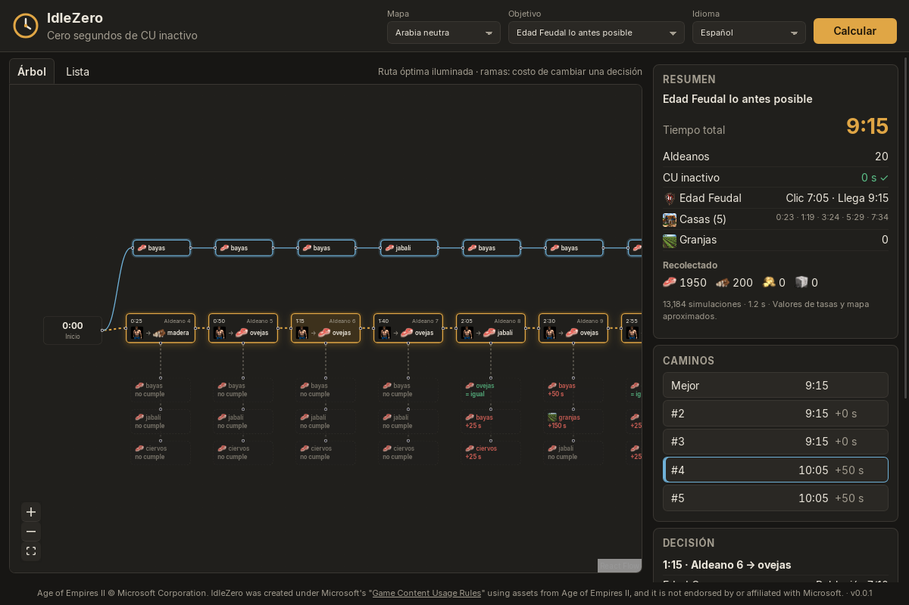

# IdleZero

App de escritorio gratuita (Linux y Windows) que calcula, aldeano por aldeano, la ruta más rápida para cumplir un objetivo en Age of Empires II: Definitive Edition, y la muestra como un mapa de decisiones.

Estado: **v0.1.0, Fases 0–3** + primer árbol visual: datos del juego, simulador económico determinista y optimizador. Solo economía (sin combate).



Eliges mapa y objetivo ("Edad Feudal lo antes posible", "Castillos", "20 arqueros"…) y la app calcula, aldeano por aldeano, la ruta más rápida sin dejar el Centro Urbano inactivo. La ruta óptima se ilumina; debajo de cada decisión, lo que costaría cambiarla ("+25 s"); arriba, otros caminos completos para comparar. La pestaña **Lista** da la orden por tick, lista para copiar.

En Arabia neutra (valores aproximados): Feudal 9:15, Castillos 15:15, ambos con 0 s de CU inactivo. Especificación completa en [docs/SPEC.md](docs/SPEC.md).

## Descargas

Solo desde [GitHub Releases](../../releases). Cada versión publica `SHA256SUMS-*.txt`; verifica tu descarga con:

```bash
sha256sum -c SHA256SUMS-Linux.txt --ignore-missing
```

| Sistema | Archivos |
| --- | --- |
| Linux | `.AppImage`, `.deb`, `.rpm` |
| Windows 10/11 | `.msi`, `-setup.exe` |

## Desarrollo

Requisitos: Rust estable, Node.js LTS y las [dependencias de sistema de Tauri 2](https://tauri.app/start/prerequisites/).

```bash
git clone https://github.com/SiegeEngineers/aoe2techtree.git vendor/aoe2techtree
cargo run -p import          # regenera data/game_data.json
cargo test --workspace
cd app && npm install && npm run tauri dev

# Simular una orden de construcción, tick a tick
cargo run -p aoe2-sim --example run -- arabia_neutra fast_castle_27_2

# Optimizar un objetivo (data/goals.toml) desde la terminal
cargo run -p aoe2-opt --example optimize -- arabia_neutra castle
```

Idiomas: español por defecto e inglés (`data/i18n/`); añadir un idioma es copiar `en.toml` y traducirlo.

Las órdenes de construcción son archivos TOML en `data/build_orders/`; las reglas, mejoras económicas y mapas también viven en `data/`.

Publicar una versión: `git tag v0.x.y && git push --tags`. GitHub Actions compila en Linux y Windows y crea un borrador de Release.

## Datos

- Unidades, edificios y tecnologías: [SiegeEngineers/aoe2techtree](https://github.com/SiegeEngineers/aoe2techtree), convertidos por `tools/import`.
- Tasas de recolección y distancias de mapa: valores de la comunidad en `data/gather_rates.toml` y `data/maps/`, marcados como aproximados hasta validarlos.

## Aviso legal

Age of Empires II © Microsoft Corporation. IdleZero was created under Microsoft's "[Game Content Usage Rules](https://www.xbox.com/en-US/developers/rules)" using assets from Age of Empires II, and it is not endorsed by or affiliated with Microsoft.

El código de este repositorio se publica bajo licencia MIT.
