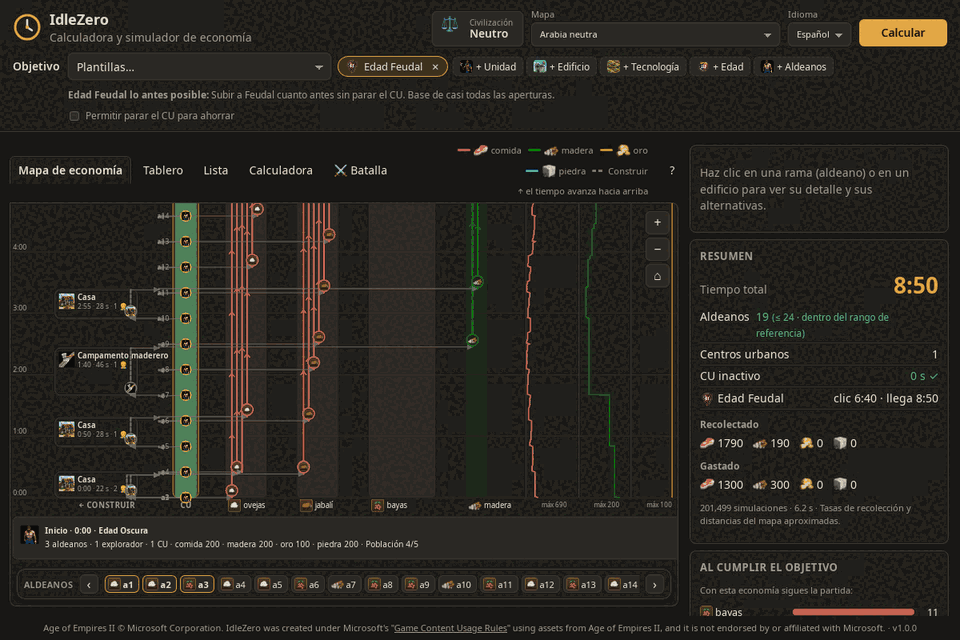
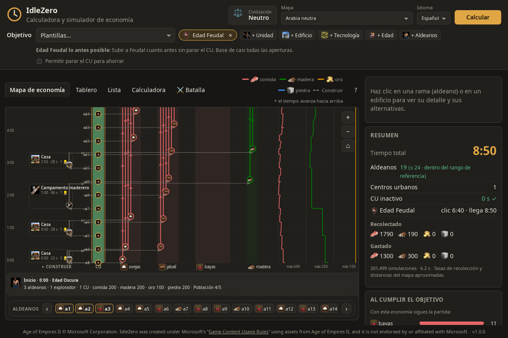

# IdleZero

IdleZero es un proyecto didáctico que modela la economía de *Age of Empires II: Definitive Edition*. A partir de un objetivo (llegar a una edad, tener ciertas unidades o edificios), simula la partida segundo a segundo y busca qué debería hacer cada aldeano para cumplirlo en el menor tiempo posible.

El resultado se muestra como un mapa que se puede recorrer: quién recolecta qué, cuándo se construye cada edificio y en qué momento hay recursos para cada cosa. La idea es entender *por qué* funciona una orden de construcción, no solo memorizarla.



## Cómo funciona

1. **Datos del juego.** Unidades, edificios, tecnologías y civilizaciones se toman de [aoe2techtree](https://github.com/SiegeEngineers/aoe2techtree). Las tasas de recolección y las distancias del mapa son valores aproximados de la comunidad y están en `data/`.
2. **Simulación.** Un simulador determinista avanza de segundo en segundo: los aldeanos caminan, recolectan, cargan y entregan recursos; el centro urbano crea aldeanos e investiga; cada pago queda registrado.
3. **Búsqueda.** El optimizador prueba miles de variantes (a qué recurso va cada aldeano, cuándo subir de edad) y se queda con la más rápida que no deja el centro urbano parado.
4. **Visualización.** La interfaz dibuja el plan como un mapa en el tiempo y permite comparar alternativas.

## Instalación

Los instaladores están en [Releases](../../releases/latest):

| Sistema | Archivo |
| --- | --- |
| Windows 10/11 | `.exe` o `.msi` |
| Ubuntu, Debian | `.deb` (`sudo apt install ./archivo.deb`) |
| Fedora, openSUSE | `.rpm` (`sudo dnf install ./archivo.rpm`) |
| Otras distribuciones Linux | `.AppImage` (dar permiso de ejecución y abrir) |

Cada versión incluye `SHA256SUMS-*.txt` para verificar la descarga (`sha256sum -c SHA256SUMS-Linux.txt --ignore-missing`). En Windows puede aparecer un aviso porque el instalador no está firmado.

## Uso

1. Elige un objetivo: una plantilla o una combinación propia de edad, aldeanos, unidades, tecnologías y edificios.
2. Elige una civilización (opcional).
3. Pulsa **Calcular**.

| Pestaña | Qué muestra |
| --- | --- |
| Mapa de economía | El plan en el tiempo: el centro urbano, lo que se construye a la izquierda, lo que recolecta cada aldeano a la derecha y las reservas de recursos. Al elegir un aldeano se ve su recorrido y qué pasaría con otra decisión. |
| Tablero | Cuándo se puede pagar cada parte del objetivo, aldeanos por recurso y reservas en el tiempo. |
| Lista | La orden como texto, en intervalos de 25 s. |
| Calculadora | Cuánto recolecta un grupo de aldeanos en una tarea concreta. |
| Batalla | Un combate simplificado entre dos ejércitos y la comparación de dos estrategias minuto a minuto. |



Hay una [guía con ejemplos](docs/guia.md) que recorre cada pestaña.

## Alcance y límites

- El modelo se centra en la economía: no incluye exploración, ataques del rival ni pérdidas.
- Los tiempos son aproximados; son más útiles para comparar dos planes que como cifra exacta.
- Hay un mapa de referencia (Arabia sin variaciones) y uno de prueba.
- Los bonos de civilización se aplican cuando el texto oficial da cifras; el resto se muestra como no simulado.
- La batalla no tiene terreno, formaciones ni control del jugador.

## Desarrollo

Requiere Rust estable, Node.js LTS y las [dependencias de Tauri 2](https://tauri.app/start/prerequisites/).

```bash
git clone https://github.com/SiegeEngineers/aoe2techtree.git vendor/aoe2techtree
cargo run -p import            # genera data/game_data.json
cargo test --workspace
cd app && npm install && npm run tauri dev
```

| Carpeta | Contenido |
| --- | --- |
| `crates/aoe2-data` | Tipos y carga de datos |
| `crates/aoe2-sim` | Simulador económico |
| `crates/aoe2-opt` | Optimizador |
| `crates/aoe2-battle` | Simulador de combate |
| `app/` | Aplicación de escritorio (Tauri + React) |
| `data/` | Datos, mapas, reglas e idiomas (español e inglés) |

El diagrama de [arquitectura](docs/arquitectura.html) muestra cómo se conectan las piezas.

## Créditos y aviso legal

Datos e íconos del juego: [SiegeEngineers/aoe2techtree](https://github.com/SiegeEngineers/aoe2techtree). Hecho por LudwingVanCat.

Age of Empires II © Microsoft Corporation. IdleZero was created under Microsoft's "[Game Content Usage Rules](https://www.xbox.com/en-US/developers/rules)" using assets from Age of Empires II, and it is not endorsed by or affiliated with Microsoft.

El código está bajo [licencia MIT](LICENSE); el contenido del juego no.
